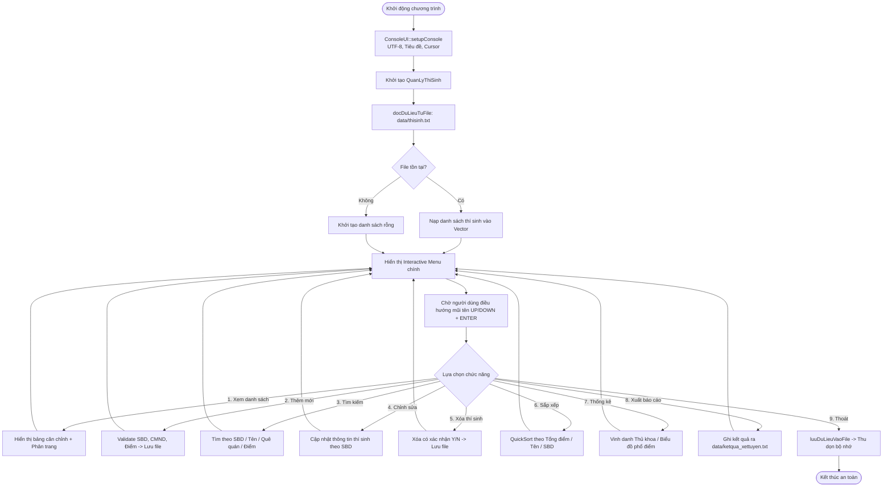

# TÀI LIỆU TOÀN DIỆN ĐỒ ÁN PBL2: HỆ THỐNG QUẢN LÝ THÍ SINH DỰ THI ĐẠI HỌC
> **Học phần**: PBL 2 - Đồ án cơ sở lập trình  
> **Trường**: Đại học Bách khoa - Đại học Đà Nẵng (DUT)  
> **Đề tài số 24**: Quản lý các thí sinh dự thi vào một trường Đại học  
> **Tác giả thực hiện**: Võ Như Hiếu  

---

## MỤC LỤC
1. [Tổng Quan Về Dự Án & Bản Chất Học Phần PBL2](#1-tổng-quan-về-dự-án--bản-chất-học-phần-pbl2)
2. [Hướng Dẫn Cài Đặt Môi Trường Cho Sinh Viên Mới](#2-hướng-dẫn-cài-đặt-môi-trường-cho-sinh-viên-mới)
3. [Kiến Trúc Hệ Thống & Thiết Kế Hướng Đối Tượng (OOP)](#3-kiến-trúc-hệ-thống--thiết-kế-hướng-đối-tượng-oop)
4. [Cấu Trúc Dữ Liệu Tự Viết: Template Vector<T>](#4-cấu-trúc-dữ-liệu-tự-viết-template-vectort)
5. [Vòng Đời Hoạt Động Của Hệ Thống (System Lifecycle)](#5-vòng-đời-hoạt-động-của-hệ-thống-system-lifecycle)
6. [Kịch Bản 5 Phút Trình Diễn Báo Cáo Trước Thầy Cô](#6-kịch-bản-5-phút-trình-diễn-báo-cáo-trước-thầy-cô)
7. [Bộ 10 Câu Hỏi Vấn Đáp Kinh Điển Của Giảng Viên & Câu Trả Lời Đạt Điểm A+](#7-bộ-10-câu-hỏi-vấn-đáp-kinh-điển-của-giảng-viên--câu-trả-lời-đạt-điểm-a)

---

## 1. TỔNG QUAN VỀ DỰ ÁN & BẢN CHẤT HỌC PHẦN PBL2

### 1.1. Mục tiêu đồ án
Đề tài 24 yêu cầu xây dựng hệ thống phần mềm hướng đối tượng bằng ngôn ngữ C++ để quản lý thông tin các thí sinh tham gia kỳ thi tuyển sinh đại học. Hệ thống giải quyết các bài toán thực tế:
- Quản lý hồ sơ nhân thân và hồ sơ thi cử của thí sinh.
- Kiểm tra tính toàn vẹn dữ liệu (Validate SBD, CMND/CCCD, ngày sinh, điểm số).
- Tìm kiếm, sắp xếp danh sách theo nhiều tiêu chuẩn tuyển sinh.
- Xét trúng tuyển theo điểm chuẩn, vinh danh thủ khoa và thống kê phổ điểm phục vụ phân tích chất lượng tuyển sinh.

### 1.2. Mối quan hệ học thuật với các môn học khác
PBL2 là học phần thực hành kết hợp song hành giữa:
1. **Lập trình Hướng đối tượng (OOP)**: Triển khai 4 tính chất cơ bản: Đóng gói (Encapsulation), Kế thừa (Inheritance), Đa hình (Polymorphism), Trừu tượng hóa (Abstraction).
2. **Cấu trúc Dữ liệu & Giải thuật**: Tự thiết kế và cài đặt mảng động `Vector<T>`, giải thuật sắp xếp `QuickSort` (không phụ thuộc vào thư viện chuẩn STL).
3. **Quản lý Tệp tin (File Database Persistence)**: Lưu trữ lâu dài dưới dạng tệp tin văn bản có định dạng.

*(Lưu ý: PBL2 là ứng dụng Desktop Console thuần C++ chạy offline, KHÔNG sử dụng Web hay cơ sở dữ liệu quan hệ như SQL Server/MySQL vốn là nội dung của học phần PBL3 ở kỳ tiếp theo).*

---

## 2. HƯỚNG DẪN CÀI ĐẶT MÔI TRƯỜNG CHO SINH VIÊN MỚI

Dự án đã được tích hợp sẵn mọi công cụ để bất kỳ sinh viên nào khi tải project về cũng có thể chạy ngay trong 1 phút.

### Cách 1: Cài đặt Dev-C++ nhanh bằng script tích hợp (Khuyên dùng)
1. Trong thư mục dự án, nhấp đúp vào file **`setup_devcpp.bat`**.
2. Một cửa sổ cài đặt Dev-C++ 5.9.2 (TDM-GCC 4.8.1) sẽ tự động mở lên từ thư mục `tools/DevCpp_Setup.exe`.
3. Nhấn **OK** (English) ➔ **I Agree** ➔ **Next** ➔ **Install** (mất khoảng 1 phút).
4. Sau khi cài xong, nhấp đúp vào **`build.bat`** để chương trình tự biên dịch và khởi chạy!

### Cách 2: Mở và chạy trực tiếp bằng phần mềm Dev-C++
1. Khởi động phần mềm Dev-C++.
2. Vào menu `File` ➔ `Open Project or File...` ➔ Chọn file **`QuanLyThiSinh.dev`**.
3. Cấu hình hỗ trợ chuẩn C++11 (chỉ cần làm lần đầu):
   - Vào menu `Tools` ➔ `Compiler Options`.
   - Tại tab `Settings` ➔ `Code Generation`, dòng **Language standard (-std)** chọn: **ISO C++11**. Nhấn **OK**.
4. Nhấn phím **F11** (hoặc `Execute` ➔ `Compile & Run`) để biên dịch và chạy.

### Cách 3: Chạy bằng file `build.bat` (Không cần mở IDE)
- Nhấp đúp chuột vào file **`build.bat`**.
- Script thông minh sẽ:
  * Tự động quét tìm trình biên dịch `g++` có sẵn trên máy (trong PATH hoặc trong các thư mục mặc định của Dev-C++, MinGW, Code::Blocks).
  * Tự động cấu hình biến môi trường `PATH` nạp các DLL cần thiết (tránh lỗi `libiconv-2.dll`).
  * Tự động biên dịch toàn bộ các file nguồn và khởi chạy file `QuanLyThiSinh.exe`.

---

## 3. KIẾN TRÚC HỆ THỐNG & THIẾT KẾ HƯỚNG ĐỐI TƯỢNG (OOP)

### 3.1. Sơ đồ phân cấp lớp (Class Diagram)

```
        +-------------------------------------------------------------+
        |                          Nguoi                              |
        |-------------------------------------------------------------|
        | # soCMND: string                                            |
        | # hoTen: string                                             |
        | # ngaySinh: string                                          |
        | # queQuan: string                                           |
        | # gioiTinh: string                                          |
        |-------------------------------------------------------------|
        | + Nguoi()                                                   |
        | + virtual ~Nguoi()                                          |
        | + virtual void nhap(istream& in = cin)                      |
        | + virtual void xuat(ostream& out = cout) const              |
        | + friend istream& operator>>(istream&, Nguoi&)              |
        | + friend ostream& operator<<(ostream&, const Nguoi&)        |
        | + Getters / Setters                                         |
        +-------------------------------------------------------------+
                                      ▲
                                      │ (Kế thừa công khai - Public Inheritance)
                                      │
        +-------------------------------------------------------------+
        |                         ThiSinh                             |
        |-------------------------------------------------------------|
        | - soBaoDanh: string                                         |
        | - diemToan: double                                          |
        | - diemLy: double                                            |
        | - diemHoa: double                                           |
        | - diemUuTien: double                                        |
        |-------------------------------------------------------------|
        | + ThiSinh()                                                 |
        | + virtual ~ThiSinh()                                        |
        | + double tinhTongDiem() const                               |
        | + double tinhDiemBaMon() const                              |
        | + bool kiemTraDiemLiet() const                              |
        | + string xepLoaiHocLuc() const                              |
        | + bool xetTrungTuyen(double diemChuan) const                |
        | + override void nhap(istream& in = cin)                     |
        | + override void xuat(ostream& out = cout) const             |
        | + Toán tử so sánh: operator<, operator>, operator==         |
        +-------------------------------------------------------------+
```

### 3.2. Bốn tính chất OOP trong dự án
1. **Tính Đóng gói (Encapsulation)**:
   - Thuộc tính của lớp `Nguoi` đặt là `protected` để cho phép lớp con kế thừa truy cập nhưng ngăn chặn bên ngoài can thiệp.
   - Thuộc tính của lớp `ThiSinh` đặt là `private`. Toàn bộ dữ liệu được truy xuất an toàn thông qua Getter/Setter và các hàm nghiệp vụ.
2. **Tính Kế thừa (Inheritance)**:
   - Lớp `ThiSinh` kế thừa toàn bộ thuộc tính nhân thân từ lớp cơ sở `Nguoi` và mở rộng thêm các thuộc tính điểm thi chuyên biệt.
3. **Tính Đa hình (Polymorphism)**:
   - Phương thức ảo `virtual void nhap()` và `virtual void xuat()` cho phép con trỏ lớp cơ sở `Nguoi*` gọi chính xác phương thức của lớp dẫn xuất `ThiSinh` trong thời gian chạy (Late Binding / Dynamic Dispatch).
   - Hàm hủy ảo `virtual ~Nguoi()` bảo đảm giải phóng trọn vẹn bộ nhớ con trỏ khi hủy đối tượng đa hình.
4. **Nạp chồng toán tử (Operator Overloading)**:
   - `operator>>` và `operator<<`: Nhập xuất đối tượng tiện lợi từ bàn phím hoặc tệp tin.
   - `operator<` và `operator>`: So sánh tổng điểm giữa 2 thí sinh phục vụ thuật toán sắp xếp.

---

## 4. CẤU TRÚC DỮ LIỆU TỰ VIẾT: TEMPLATE VECTOR<T>

Thay vì sử dụng thư viện chuẩn `std::vector`, dự án tự xây dựng hoàn toàn lớp `Vector<T>` trong file [include/Vector.h](file:///d:/HOCTAP/pbl2/pbl2_MyProJect/include/Vector.h):

### 4.1. Cơ chế quản lý bộ nhớ động
- **Con trỏ vùng nhớ**: `T* data` quản lý vùng nhớ được cấp phát bằng toán tử `new[]`.
- **Dung lượng (Capacity) và Số phần tử (Size)**:
  * Khi số lượng phần tử `m_size` chạm ngưỡng `m_capacity`, hàm `reallocate` sẽ tự động cấp phát một vùng nhớ mới có dung lượng gấp đôi (`m_capacity * 2`), sao chép toàn bộ phần tử cũ sang và giải phóng vùng nhớ cũ bằng `delete[]`.
- **Quy tắc bộ ba (Rule of Three)**:
  * Cài đặt đầy đủ: **Destructor** (giải phóng con trỏ), **Copy Constructor** (sao chép sâu - Deep Copy), và **Copy Assignment Operator** (`operator=`) để tránh hiện tượng rò rỉ bộ nhớ (Memory Leak) hoặc treo chương trình do giải phóng 2 lần (Dangling Pointer / Double Free).

### 4.2. Tích hợp giải thuật sắp xếp QuickSort
Hàm `sort(bool (*compare)(const T&, const T&))` nhận vào một con trỏ hàm so sánh (Comparator function pointer), triển khai thuật toán phân hoạch Hoare với độ phức tạp trung bình **O(N log N)**, cho phép sắp xếp danh sách theo bất kỳ tiêu chuẩn nào (tổng điểm giảm dần, tên A-Z, SBD tăng dần).

---

## 5. VÒNG ĐỜI HOẠT ĐỘNG CỦA HỆ THỐNG (SYSTEM LIFECYCLE)



---

## 6. KỊCH BẢN 5 PHÚT TRÌNH DIỄN BÁO CÁO TRƯỚC THẦY CÔ

Để tạo ấn tượng xuất sắc và đạt điểm tối đa (A/A+) trong buổi bảo vệ đồ án, con hãy thực hiện theo đúng kịch bản 5 bước vàng sau:

* **Phút 1: Giới thiệu & Trình diễn Giao diện:**
  - Chạy chương trình, chỉ cho thầy cô thấy menu điều khiển bằng phím mũi tên **▲ / ▼** mượt mà.
  - Chọn mục `1. Xem toàn bộ danh sách thí sinh`.
  - Nhấn phím `D` để sang **Trang [ 2 / 2 ]**, nhấn phím `A` để quay về **Trang [ 1 / 2 ]**. Giải thích: *"Hệ thống có cơ chế phân trang tự động, mỗi trang tối đa 12 thí sinh để bảng không bao giờ bị tràn màn hình console."*

* **Phút 2: Trình diễn Thao tác Thêm mới & Kiểm tra dữ liệu (Validate):**
  - Chọn mục `2. Thêm thí sinh mới`.
  - Cố tình nhập trùng Số báo danh `DUT001` ➔ Hệ thống lập tức báo đỏ: `[LOI] So Bao Danh da ton tai tren he thong!`.
  - Nhập ngày sinh sai dạng (ví dụ `31/02/2005`) ➔ Hệ thống báo lỗi ngày không hợp lệ.
  - Nhập điểm thi ngoài khoảng 0-10 (ví dụ `11`) ➔ Hệ thống từ chối.
  - Sau đó nhập một thí sinh chuẩn để thấy thông báo thêm thành công và giải thích: *"Dữ liệu ngay lập tức được ghi bền vững vào file `data/thisinh.txt`."*

* **Phút 3: Trình diễn Tìm kiếm Đa tiêu chí:**
  - Vào mục `3. Tìm kiếm`.
  - Tìm theo tên: Gõ `an` (chữ thường) ➔ Hệ thống vẫn tìm ra `Nguyen Van An` và `Hoang Thi Ha` (giải thích cơ chế tìm kiếm xâu con không phân biệt hoa thường).
  - Tìm theo quê quán: Nhập `Da Nang`.

* **Phút 4: Trình diễn Giải thuật Sắp xếp Bảng Xếp Hạng:**
  - Chọn mục `6 ➔ 1. Sap xep theo Tong Diem giam dan`.
  - Bảng xếp hạng điểm thi từ cao xuống thấp hiện ra ngay lập tức. Giới thiệu với thầy cô: *"Em sử dụng thuật toán QuickSort tự cài đặt bên trong cấu trúc dữ liệu Template `Vector<T>`, không dùng hàm sort của thư viện chuẩn STL."*

* **Phút 5: Vinh danh Thủ khoa & Thống kê Phổ điểm Tuyển sinh:**
  - Chọn mục `7 ➔ 1. Vinh danh Thu Khoa` ➔ Màn hình chúc mừng thủ khoa xuất sắc nhất kỳ thi hiện ra.
  - Chọn mục `7 ➔ 3. Thong ke Pho Diem` ➔ Chỉ cho thầy cô thấy bảng tỷ lệ phần trăm và biểu đồ thanh trực quan theo từng phân khúc học lực.
  - Chọn mục `8. Xuat bao cao` ➔ Mở file [data/ketqua_xettuyen.txt](file:///d:/HOCTAP/pbl2/pbl2_MyProJect/data/ketqua_xettuyen.txt) minh chứng kết quả xuất file.

---

## 7. BỘ 10 CÂU HỎI VẤN ĐÁP KINH ĐIỂN CỦA GIẢNG VIÊN & CÂU TRẢ LỜI ĐẠT ĐIỂM A+

### ❓ Câu 1: Tại sao trong lớp cơ sở `Nguoi` em phải khai báo Destructor là ảo (`virtual ~Nguoi()`)? Nếu bỏ từ khóa `virtual` thì có hậu quả gì?
* **Trả lời chuẩn A+:**
  > *"Dạ thưa thầy/cô, trong mô hình kế thừa, khi ta quản lý đối tượng lớp con `ThiSinh` thông qua con trỏ lớp cha `Nguoi*` (đa hình), việc khai báo `virtual ~Nguoi()` sẽ kích hoạt cơ chế liên kết động (Dynamic Binding). Khi ta gọi lệnh `delete ptr`, chương trình sẽ gọi đúng Destructor của lớp con `~ThiSinh()` trước để giải phóng bộ nhớ của lớp con, rồi mới gọi đến `~Nguoi()`.  
  > Nếu không có từ khóa `virtual`, trình biên dịch sẽ chỉ liên kết tĩnh và chỉ gọi duy nhất Destructor của lớp cha `~Nguoi()`, dẫn đến các vùng nhớ hoặc tài nguyên riêng của lớp con sẽ bị bỏ sót, gây ra lỗi rò rỉ bộ nhớ (Memory Leak)."*

---

### ❓ Câu 2: Cấu trúc `Vector<T>` của em tự viết hoạt động như thế nào? Cơ chế tăng dung lượng (capacity) ra sao?
* **Trả lời chuẩn A+:**
  > *"Dạ thưa thầy/cô, `Vector<T>` của em là một mảng động tự co giãn. Nó lưu 3 biến chính: con trỏ `T* data`, `m_size` (số phần tử hiện tại) và `m_capacity` (dung lượng vùng nhớ đã cấp phát).  
  > Mỗi khi thêm phần tử bằng `push_back`, nếu `m_size >= m_capacity`, hàm `reallocate` sẽ cấp phát một vùng nhớ mới có dung lượng gấp đôi (`m_capacity * 2`), sao chép toàn bộ phần tử cũ sang và giải phóng vùng nhớ cũ bằng `delete[]`. Kỹ thuật nhân đôi dung lượng này giúp chi phí thời gian trung bình (Amortized Time Complexity) cho mỗi lần thêm phần tử chỉ là **O(1)**."*

---

### ❓ Câu 3: Thuật toán QuickSort trong `Vector.h` hoạt động thế nào? Độ phức tạp thuật toán là bao nhiêu?
* **Trả lời chuẩn A+:**
  > *"Dạ thưa thầy/cô, QuickSort là thuật toán chia để trị (Divide and Conquer). Thuật toán chọn một phần tử chốt (Pivot) ở giữa mảng `(left + right) / 2`, sau đó dùng hai con trỏ `i` và `j` quét từ hai đầu để phân hoạch: dồn tất cả các phần tử nhỏ hơn chốt về một bên và lớn hơn chốt về bên còn lại. Sau đó gọi đệ quy tiếp cho hai nửa mảng con.  
  > Độ phức tạp trung bình của giải thuật là **O(N log N)**. Điểm đặc biệt trong cấu trúc của em là em truyền vào một con trỏ hàm so sánh `bool (*compare)(const T&, const T&)`, nhờ vậy em có thể tái sử dụng một hàm sort duy nhất cho mọi tiêu chí sắp xếp khác nhau (theo điểm, theo tên, theo SBD)."*

---

### ❓ Câu 4: Tại sao các toán tử `operator>>` và `operator<<` phải khai báo là hàm `friend` mà không phải phương thức của lớp?
* **Trả lời chuẩn A+:**
  > *"Dạ thưa thầy/cô, toán tử nhập xuất luồng có cú pháp là `cin >> ts` hoặc `cout << ts`. Trong biểu thức này, toán hạng bên trái là đối tượng của luồng `istream` hoặc `ostream`, không phải là đối tượng `ThiSinh`.  
  > Nếu cài đặt dưới dạng phương thức thành viên của lớp `ThiSinh`, toán hạng bên trái bắt buộc phải là `ThiSinh` (tức là cú pháp sẽ bị ngược thành `ts >> cin`). Do đó, ta bắt buộc phải cài đặt `operator>>` và `operator<<` dưới dạng hàm toàn cục độc lập và đặt từ khóa `friend` bên trong lớp để hàm có quyền truy cập trực tiếp vào các thuộc tính `private`/`protected` của lớp."*

---

### ❓ Câu 5: Quyền truy xuất `protected` trong lớp `Nguoi` khác gì so với `private`?
* **Trả lời chuẩn A+:**
  > *"Dạ thưa thầy/cô:  
  > - `private`: Chỉ có các phương thức nội bộ của chính lớp đó mới được phép truy cập. Các lớp con kế thừa cũng không thể truy cập trực tiếp.  
  > - `protected`: Các đối tượng bên ngoài phạm vi lớp hoàn toàn không truy cập được (bảo toàn tính đóng gói), nhưng **các lớp con kế thừa từ nó (như lớp `ThiSinh`) thì được phép truy cập trực tiếp**.  
  > Trong bài toán của em, em để các thông tin `soCMND`, `hoTen`... là `protected` để lớp `ThiSinh` có thể trực tiếp sử dụng lại khi thực hiện các phép tính toán hoặc xuất bảng mà không cần phải gọi qua getter trung gian, giúp mã nguồn tường minh và tối ưu hiệu năng."*

---

### ❓ Câu 6: Làm thế nào chương trình đảm bảo Số báo danh (SBD) và CMND/CCCD không bị trùng lặp?
* **Trả lời chuẩn A+:**
  > *"Dạ thưa thầy/cô, trong hàm `themThiSinh` của lớp `QuanLyThiSinh`, trước khi thêm bất kỳ thí sinh nào vào danh sách, hệ thống đều thực hiện 2 vòng kiểm tra:  
  > 1. Gọi hàm `timViTriTheoSBD(sbd)` để quét toàn bộ Vector xem SBD đã tồn tại chưa.  
  > 2. Quét trường `soCMND` của tất cả các phần tử hiện có để kiểm tra trùng số căn cước.  
  > Chỉ khi cả hai điều kiện đều là duy nhất thì đối tượng mới được đưa vào danh sách và lưu vào file. Nhờ vậy cơ sở dữ liệu luôn đảm bảo tính toàn vẹn và duy nhất (Unique Constraint)."*

---

### ❓ Câu 7: Cơ chế phân trang (Pagination) trên Console hoạt động như thế nào?
* **Trả lời chuẩn A+:**
  > *"Dạ thưa thầy/cô, để tránh việc danh sách có hàng chục hay hàng trăm thí sinh làm trôi màn hình console, em quy định mỗi trang hiển thị cố định `PAGE_SIZE = 12` bản ghi.  
  > Tổng số trang được tính bằng công thức: `totalPages = (size + PAGE_SIZE - 1) / PAGE_SIZE`.  
  > Vòng lặp hiển thị sẽ chỉ duyệt từ chỉ số `startIdx = currentPage * PAGE_SIZE` đến `endIdx`. Người dùng có thể nhấn phím `A` để giảm trang, phím `D` để tăng trang hoặc `ESC` để quay lại. Điều này giúp giao diện hiển thị gọn gàng, chuyên nghiệp như một ứng dụng thực tế."*

---

### ❓ Câu 8: Tại sao em không dùng cơ sở dữ liệu MySQL hay SQL Server cho đồ án này?
* **Trả lời chuẩn A+:**
  > *"Dạ thưa thầy/cô, theo đề cương chuẩn đầu ra của học phần PBL2 (Đồ án Cơ sở lập trình), mục tiêu cốt lõi là đánh giá năng lực của sinh viên về **Lập trình Hướng đối tượng**, **Kỹ năng thao tác con trỏ/quản lý bộ nhớ** và **Xây dựng cấu trúc dữ liệu cơ sở**.  
  > Việc lưu trữ dữ liệu dưới dạng File có cấu trúc và tự nạp vào `Vector<T>` giúp em rèn luyện sâu sắc bản chất cách máy tính tổ chức dữ liệu trong RAM và ghi xuống đĩa cứng. Còn các hệ quản trị CSDL quan hệ như SQL Server hay MySQL sẽ được em áp dụng trong đồ án PBL3 (Công nghệ phần mềm) ở học kỳ sau ạ."*

---

### ❓ Câu 9: Trong lớp `Vector<T>`, Copy Constructor và toán tử gán `operator=` khác nhau như thế nào?
* **Trả lời chuẩn A+:**
  > *"Dạ thưa thầy/cô:  
  > - **Copy Constructor**: Được gọi khi một đối tượng Vector **mới đang được tạo ra** từ một đối tượng đã có từ trước (Ví dụ: `Vector<ThiSinh> v2 = v1;` hoặc khi truyền tham trị vào hàm).  
  > - **Toán tử gán `operator=`**: Được gọi khi **cả hai đối tượng đều đã tồn tại sẵn trong bộ nhớ** và ta thực hiện gán giá trị của đối tượng này cho đối tượng kia (Ví dụ: `v2 = v1;`). Khi này, `operator=` phải kiểm tra tự gán (`this != &other`), giải phóng vùng nhớ cũ của chính nó trước khi cấp phát vùng nhớ mới để tránh rò rỉ bộ nhớ."*

---

### ❓ Câu 10: Nếu sau này trường Đại học muốn mở rộng thêm đối tượng Giám thị coi thi hoặc Giảng viên chấm thi thì kiến trúc của em có dễ nâng cấp không?
* **Trả lời chuẩn A+:**
  > *"Dạ thưa thầy/cô, kiến trúc hệ thống của em tuân thủ chặt chẽ nguyên lý **Open-Closed Principle (Mở để mở rộng, Đóng để sửa đổi)** trong SOLID:  
  > Em chỉ cần tạo thêm lớp `GiamThi` hoặc `GiangVien` kế thừa từ lớp cơ sở `Nguoi` đã có sẵn (tái sử dụng toàn bộ thông tin CMND, Họ tên, Ngày sinh, Quê quán...). Lớp `Nguoi` và các lớp quản lý cũ hoàn toàn không cần phải sửa đổi hay viết lại, đảm bảo tính kế thừa và mở rộng hệ thống cực kỳ linh hoạt ạ!"*

---

*Tài liệu được biên soạn chuẩn mực cho đồ án PBL2 - Khoa CNTT - Đại học Bách khoa Đà Nẵng.*
