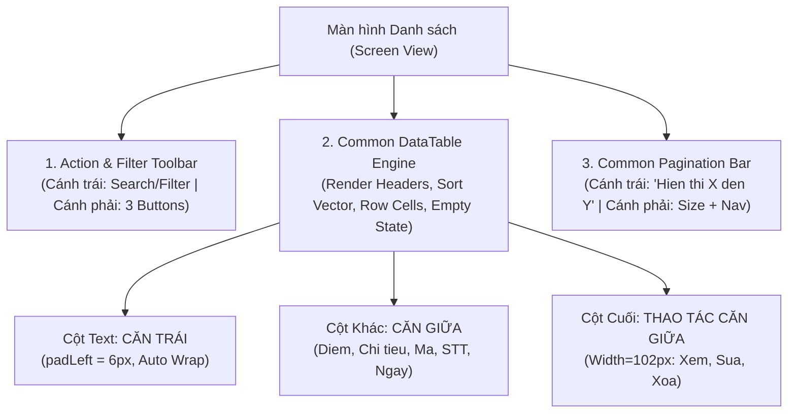

# KẾ HOẠCH TRIỂN KHAI (IMPLEMENTATION PLAN)
## ĐẠI TU & CHUẨN HÓA TOÀN DIỆN HỆ THỐNG BẢNG DÙNG CHUNG (COMMON TABLE ARCHITECTURE)
### Dự án PBL2 (Đề tài 24): Hệ Thống Quản Lý Thí Sinh Tuyển Sinh Đại Học Bách Khoa - ĐH Đà Nẵng (DUT)
### Mô hình tham chiếu: `sdt-baocaodieuhanh` (`frontend/src/components/table`)

---

### I. TỔNG QUAN & BỐI CẢNH YÊU CẦU

Trong quá trình phát triển hệ thống, các màn hình hiển thị dữ liệu dạng bảng (Table Views) trải rộng qua 5 Tab nghiệp vụ lớn:
1. **Tab 1**: Quản lý Hồ sơ Thí sinh (Màn hình chính, đã được tối ưu đạt chuẩn thẩm mỹ cao).
2. **Tab 2**: Cơ sở Dữ liệu Quan hệ (10 Subtab cho 10 bảng thực thể 3NF trong MySQL).
3. **Tab 3**: Xét tuyển & Thống kê DUT (Bảng Chỉ tiêu & Điểm chuẩn chốt, Bảng Tân sinh viên phân lớp, Bảng Thủ khoa & Phổ điểm).
4. **Tab 4**: Quản lý Danh mục Hệ thống (Khoa, Ngành đào tạo, Chỉ tiêu động, Tỉnh thành, Giới tính, Cấu hình).
5. **Tab 5**: Lưu trữ & Báo cáo thống kê.

#### Vấn đề hiện tại:
- **Thiếu tính đồng bộ (UI Fragmentation)**: Mỗi Tab/Subtab đang tự vẽ bảng theo cách riêng (cách dùng cờ ImGui khác nhau, một số bảng thiếu thanh cuộn, một số bảng cuộn ngang méo mó, bảng thì có nút thao tác, bảng thì không).
- **Hệ thống nút hành động phân tán**: Nút bấm trên thanh công cụ mỗi nơi đặt một tên (`[+] Them Thi Sinh]`, `[Xuat DS Trung Tuyen DUT]`, `[Cap nhat]`...), gây rối mắt và không theo quy chuẩn chung.
- **Căn lề dữ liệu lộn xộn**: Cột chữ và cột số căn lề chưa thống nhất.
- **Phân trang cục bộ**: Nhiều bảng tải toàn bộ hàng trăm/hàng nghìn dòng một lúc hoặc thiếu phân trang Server-side, gây nghẽn giao diện khi dữ liệu lớn.

#### Mục tiêu tối thượng của đợt Refactor này:
- Xây dựng **Kiến trúc Bảng Dùng Chung (Common Table Architecture)** chuẩn mực theo mô hình Component chuyên nghiệp từ dự án mẫu: `D:\CONGVIEC\SDT\BAO_CAO_DIEU_HANH\sdt-baocaodieuhanh\frontend\src\components\table`.
- Lấy **Bảng Quản lý Hồ sơ Thí sinh (Tab 1)** làm **tiêu chuẩn vàng (Golden Standard)** kết hợp kiến trúc phân rã component hiện đại.
- Mọi màn hình danh sách đều sở hữu:
  1. **Bộ 3 nút hành động chuẩn ngữ nghĩa**: `[+ Thêm mới]`, `[ Xuất Excel ]`, `[+ Import dữ liệu mẫu]`.
  2. **Thanh phân trang Server-side chuẩn**: Chọn kích thước trang (10, 25, 50, 100/trang), hiển thị dải bản ghi, điều hướng 5 nút (`|<<`, `<`, Trang X/Y, `>`, `>>`), đếm tổng bản ghi chính xác.
  3. **Cột thao tác chuẩn (Cột cuối cùng)**: 3 icon button vector tinh tế: `[Xem chi tiết]` (Mắt), `[Sửa]` (Bút chì), `[Xóa]` (Thùng rác), khóa cứng độ rộng và căn giữa 100%.
  4. **Quy tắc căn chỉnh dữ liệu chuẩn mực (Theo chỉ đạo trực tiếp của Đệ tử)**:
     - **Cột Text (Văn bản / Chuỗi dài)**: **CĂN TRÁI** (`AlignAndRenderTextLeft` có `padLeft = 6.0f`, tự động wrap dòng).
     - **TẤT CẢ các cột còn lại (Điểm số, Chỉ tiêu, Số lượng, Mã số, Ngày sinh, Giới tính, Lớp, Mã SV, STT...)**: **CĂN GIỮA** (`AlignAndRenderCenter` cân xứng, thanh thoát).

---

### II. THIẾT KẾ KIẾN TRÚC THAM CHIẾU TỪ `sdt-baocaodieuhanh`

Qua phân tích cấu trúc component tại `D:\CONGVIEC\SDT\BAO_CAO_DIEU_HANH\sdt-baocaodieuhanh\frontend\src\components\table` bao gồm:
- `Table.vue`: Điều phối Header Action Toolbar, Search Filter, Danh sách Columns, Trạng thái Không có kết quả (`customize-noResult`), Slot Thao tác (`thaoTac`).
- `PaginationV.vue` & `PaginationRight.vue`: Phân tách rành mạch 2 cánh: Cánh trái hiển thị số đếm bản ghi (`hienThiTu ... den ... cua ... muc`), cánh phải chọn `selectPageSize`, `pages/pageCount` và cụm nút chuyển trang.
- `index.vue` / `TableModal.vue`: Đóng gói cấu trúc bảng tái sử dụng với mảng `columns` linh hoạt.

Chúng ta chuyển dịch kiến trúc Vue/Component này sang kiến trúc **C++ Dear ImGui** chuẩn mực như sau:



---

### III. ĐẶC TẢ CHI TIẾT CÁC THÀNH PHẦN KỸ THUẬT C++

#### 1. Cấu trúc Quản lý Trạng thái Phân trang Server-side (`PaginationState`)
Định nghĩa struct quản lý trạng thái phân trang tập trung, có thể tái sử dụng cho bất kỳ thực thể nào (tương đồng với `items` prop trong `Table.vue`):

```cpp
struct PaginationState {
    int currentPage = 1;
    int pageSize = 10;
    int totalRecords = 0;
    int totalPages = 1;
    int sortCol = -1;
    bool sortAsc = true;

    // Tính toán vị trí offset trong câu truy vấn SQL (LIMIT pageSize OFFSET offset)
    int getOffset() const {
        return (currentPage - 1) * pageSize;
    }

    // Cập nhật lại số trang khi tổng bản ghi thay đổi
    void updateTotalRecords(int count) {
        totalRecords = count;
        totalPages = (totalRecords <= 0) ? 1 : ((totalRecords + pageSize - 1) / pageSize);
        if (currentPage > totalPages) currentPage = totalPages;
        if (currentPage < 1) currentPage = 1;
    }

    // Nhãn hiển thị phạm vi bản ghi tương ứng với PaginationV.vue: "Hien thi tu X den Y cua Z muc"
    void getRangeDisplay(int& fromIdx, int& toIdx) const {
        if (totalRecords == 0) {
            fromIdx = 0;
            toIdx = 0;
            return;
        }
        fromIdx = getOffset() + 1;
        toIdx = (fromIdx + pageSize - 1 > totalRecords) ? totalRecords : (fromIdx + pageSize - 1);
    }
};
```

#### 2. Cấu trúc Cột Bảng Linh Hoạt (`TableColumnConfig`)
Tương ứng với mảng `headers` trong `Table.vue`, định nghĩa cấu hình metadata cho từng cột:

```cpp
enum class ColumnAlign {
    Left,    // Áp dụng cho text, chuỗi dài, họ tên, khoa, ngành, ghi chú
    Center   // Áp dụng cho TOÀN BỘ CỘT CÒN LẠI: điểm số, chỉ tiêu, số lượng, STT, mã số, ngày sinh, lớp...
};

struct TableColumnConfig {
    string headerName;
    ColumnAlign align;
    float widthOrWeight;
    bool isStretch;      // true: WidthStretch, false: WidthFixed
    bool isSortable;
    bool isActionColumn; // Cột thao tác cuối cùng (102px cố định)
};
```

#### 3. Thanh Công Cụ Hành Động Chuẩn (`Common Action Toolbar`)
Tương đồng với slot `divAction` và `isSearch` trong `Table.vue`:
- **Bên trái**: Ô tìm kiếm / bộ lọc chuyên biệt của từng màn hình.
- **Bên phải**: Bộ 3 nút chuẩn mang ngữ nghĩa hành động rõ ràng:
  - `[+ Thêm mới]` (Màu xanh lục Emerald `#22C55E` - Hover `#16A34A`): Mở Modal tạo mới thực thể tương ứng.
  - `[ Xuất Excel ]` (Màu xanh dương Navy `#3B82F6` - Hover `#2563EB`): Xuất báo cáo theo bộ lọc sang file `.xls` định dạng Microsoft XML Spreadsheet 2003 chuẩn hoá.
  - `[+ Import dữ liệu mẫu]` (Màu tím/Chàm Indigo `#6366F1` - Hover `#4F46E5`): Nạp bộ dữ liệu mẫu chuẩn của thực thể đó vào MySQL.

```cpp
struct ActionToolbarFlags {
    bool showAdd = true;
    bool showExport = true;
    bool showImport = true;
    string customAddLabel = "+ Them moi";
    string customExportLabel = "Xuat Excel";
    string customImportLabel = "+ Import du lieu mau";
};

// Hàm render thanh công cụ dùng chung
void RenderCommonActionToolbar(const string& screenId,
                               const ActionToolbarFlags& flags,
                               bool& outAddClicked,
                               bool& outExportClicked,
                               bool& outImportClicked);
```

#### 4. Khung Bảng Dùng Chung (`Common Table Layout`)
- **Flags bắt buộc**:
  ```cpp
  ImGuiTableFlags tableFlags = ImGuiTableFlags_Borders | 
                               ImGuiTableFlags_RowBg | 
                               ImGuiTableFlags_Resizable | 
                               ImGuiTableFlags_Sortable | 
                               ImGuiTableFlags_SizingStretchProp | 
                               ImGuiTableFlags_NoSavedSettings;
  ```
- **Thead Vector**: Tự động render mũi tên vector sắc nét ▲/▼ cho mọi cột `isSortable`.
- **Trạng thái Rỗng (Empty State - `customize-noResult`)**:
  Khi danh sách không có dữ liệu (`totalRecords == 0`), tự động render hàng thông báo căn giữa với màu cam nhạt thanh lịch: *"Khong tim thay du lieu phu hop"*.
- **Cột Thao Tác (Action Column)**:
  - Khóa độ rộng cố định: `102.0f`, cờ `ImGuiTableColumnFlags_WidthFixed | ImGuiTableColumnFlags_NoResize | ImGuiTableColumnFlags_NoSort`.
  - Cụm 3 Icon Buttons căn giữa hoàn hảo theo chiều ngang và dọc:
    + **Icon 1 (Xem chi tiết - Con mắt)**: Kích thước 26x22px, màu Teal (`#248270`), mở Modal xem chi tiết.
    + **Icon 2 (Sửa - Bút chì)**: Kích thước 26x22px, màu Blue (`#2D72D2`), mở Modal chỉnh sửa.
    + **Icon 3 (Xóa - Thùng rác)**: Kích thước 26x22px, màu Red (`#D33838`), mở Modal xác nhận xóa an toàn.

#### 5. Thanh Phân Trang Chuẩn (`Common Pagination Bar`)
Bố cục mô phỏng chuẩn xác từ `PaginationV.vue`:
```
+----------------------------------------------------------------------------------------------------+
|  Hien thi tu 1 den 10 cua 100 muc         So hang: [ 10 / trang v ]   [|<<]  [<]  Trang 1/10  [>]  [>>]|
+----------------------------------------------------------------------------------------------------+
```
- **Cánh trái**: Nhãn hiển thị phạm vi bản ghi: `Hien thi tu X den Y cua Z muc` (hoặc `Dang hien thi 0 ket qua`).
- **Cánh phải**:
  1. Dropdown chọn `Số hàng` (`pageSize`): `10 / trang`, `25 / trang`, `50 / trang`, `100 / trang`.
  2. Cụm 5 nút điều hướng:
     - `|<< Đầu`: Về trang 1.
     - `< Trước`: Về trang `currentPage - 1`.
     - `Trang X / Y`: Nhãn hiển thị trang hiện tại / tổng số trang.
     - `Sau >`: Đến trang `currentPage + 1`.
     - `Cuối >>`: Đến trang cuối cùng.
     - Tự động Disable các nút khi ở đầu hoặc cuối danh sách.

---

### IV. QUY CHUẨN CĂN LỀ DỮ LIỆU TOÀN DIỆN (ALIGNMENT RULES)

Tuân thủ nghiêm ngặt theo chỉ đạo của đệ tử: **"Cột có dữ liệu là text căn trái, CÒN LẠI CĂN GIỮA"**:

| Phân nhóm dữ liệu | Danh sách các cột thuộc nhóm | Phương thức căn chỉnh | Quy cách hiển thị |
|:---|:---|:---:|:---|
| **Văn bản (Text / Chuỗi dài)** | Họ và tên, Tên Khoa, Tên Ngành, Tên Tỉnh thành, Trạng thái xét tuyển, Ghi chú mô tả cấu hình | **CĂN TRÁI (`AlignAndRenderTextLeft`)** | Có đệm lề trái `padLeft = 6.0f`, tự động wrap dòng khi bề rộng ô hẹp, căn giữa theo trục dọc. |
| **Điểm số & Điểm chuẩn** | Điểm Toán, Điểm Lý, Điểm Hóa, Tổng Điểm, Điểm Chuẩn Chốt, Điểm Sàn Tối Thiểu | **CĂN GIỮA (`AlignAndRenderCenter`)** | Căn giữa tuyệt đối trong ô, định dạng số thập phân 2 chữ số (`%.2f`). |
| **Số lượng & Chỉ tiêu** | Chỉ tiêu tuyển sinh, Sĩ số lớp chuẩn, Số lượng trúng tuyển thực tế, Số lượng nguyện vọng | **CĂN GIỮA (`AlignAndRenderCenter`)** | Căn giữa tuyệt đối, hiển thị số nguyên rõ ràng. |
| **Định danh & Mã số cố định** | STT, Số báo danh (`DUT001`), Số CCCD, Mã SV DUT (`102260001`), Lớp sinh hoạt (`26T_N1`), Mã Tỉnh (`48`), Mã Giới tính (`NAM`) | **CĂN GIỮA (`AlignAndRenderCenter`)** | Căn giữa tuyệt đối trong ô, giữ trọn vẹn số 0 ở đầu (`048`, `0643...`). |
| **Ngày tháng & Thời gian** | Ngày sinh (`dd/mm/yyyy`), Năm tuyển sinh (`2026`) | **CĂN GIỮA (`AlignAndRenderCenter`)** | Căn giữa tuyệt đối, không ngắt dòng. |
| **Cột Thao Tác (Actions)** | Cụm 3 nút `[Xem chi tiết]` `[Sửa]` `[Xóa]` | **CĂN GIỮA** | Tâm cụm nút 86px luôn nằm chính giữa tâm cột 102px cả trục X và trục Y. |

---

### V. DANH SÁCH CÁC MÀN HÌNH ĐƯỢC CHUẨN HÓA

| STT | Màn hình / Tab | Thực thể CSDL | Thao tác [Thêm mới] | Thao tác [Xuất Excel] | Thao tác [Import mẫu] | Cột Thao tác [Xem / Sửa / Xóa] |
|:---:|:---|:---|:---|:---|:---|:---:|
| **1** | **Tab 1: Quản lý Hồ sơ Thí sinh** | `thisinh` + `nguoi` + `nguyen_vong` | Thêm Thí sinh mới | Xuất báo cáo lọc Thí sinh | Nạp 100 Thí sinh mẫu K26 | Đầy đủ 3 nút |
| **2** | **Tab 3.1: Chỉ tiêu & Điểm chuẩn chốt** | `nganh_theo_khoa_hoc` | Thiết lập ngành tuyển sinh mới | Xuất bảng điểm chuẩn chốt | Nạp chỉ tiêu & điểm chuẩn K26 | Sửa chỉ tiêu / Điểm sàn |
| **3** | **Tab 3.2: Tân sinh viên & Phân lớp** | `thisinh` trúng tuyển | Ghi danh sinh viên bổ sung | Xuất danh sách phân lớp DUT | Nạp danh sách trúng tuyển mẫu | Đầy đủ 3 nút |
| **4** | **Tab 3.3: Thủ khoa & Phổ điểm** | Thí sinh top điểm | - | Xuất danh sách Thủ khoa | - | Xem chi tiết hồ sơ |
| **5** | **Tab 4.1: Danh mục Khoa đào tạo** | `khoa` | Thêm Khoa đào tạo | Xuất danh mục Khoa | Nạp 14 Khoa chuẩn DUT | Đầy đủ 3 nút |
| **6** | **Tab 4.2: Danh mục Ngành tuyển sinh** | `danh_muc_nganh` | Thêm Ngành đào tạo mới | Xuất danh mục Ngành | Nạp 12 Ngành chuẩn DUT | Đầy đủ 3 nút |
| **7** | **Tab 4.3: Chỉ tiêu K26 Biến động** | `nganh_theo_khoa_hoc` | Thêm chỉ tiêu khóa mới | Xuất chỉ tiêu K26 | Nạp chỉ tiêu mặc định | Sửa chỉ tiêu / điểm sàn |
| **8** | **Tab 4.4: Danh mục Tỉnh / Thành** | `tinh_thanh` | Thêm Tỉnh/Thành phố | Xuất danh mục Tỉnh | Nạp 63 Tỉnh/Thành VN | Đầy đủ 3 nút |
| **9** | **Tab 4.5: Danh mục Giới tính** | `gioi_tinh` | Thêm định danh Giới tính | Xuất danh mục Giới tính | Nạp 3 Giới tính chuẩn | Đầy đủ 3 nút |
| **10** | **Tab 4.6: Cấu hình Hệ thống** | `cau_hinh` | Thêm tham số mới | Xuất bảng cấu hình | Nạp cấu hình mặc định | Sửa tham số cấu hình |
| **11** | **Tab 2: 10 Bảng dữ liệu quan hệ** | 10 Bảng MySQL 3NF | Tương ứng từng bảng | Xuất dữ liệu bảng | Nạp dữ liệu bảng | Đầy đủ 3 nút |

---

### VI. KẾ HOẠCH TRIỂN KHAI THEO TỪNG GIAI ĐOẠN (ROADMAP)

#### Giai đoạn 1: Xây dựng Bộ Khung Dùng Chung (Common Table Framework)
- **File tác động**: `include/AppGUI.h`, `src/AppGUI.cpp`.
- **Nội dung công việc**:
  1. Hiện thực hóa các hàm dùng chung theo kiến trúc component tham chiếu:
     - `RenderCommonActionToolbar(...)`
     - `RenderCommonPaginationBar(...)`
     - `RenderCommonActionCell(...)`
     - `AlignAndRenderTextLeft(...)` (cho text)
     - `AlignAndRenderCenter(...)` (cho toàn bộ các loại dữ liệu còn lại).
  2. Tạo bộ style chuẩn cho 3 nút `[+ Thêm mới]`, `[ Xuất Excel ]`, `[+ Import dữ liệu mẫu]`.

#### Giai đoạn 2: Refactor Tab 4 (Quản lý Danh mục Hệ thống)
- **Mục tiêu**: Áp dụng Framework mới cho các bảng danh mục quản trị (Tỉnh thành, Giới tính, Khoa, Ngành, Cấu hình).
- **Lợi ích**: Danh mục có cấu trúc bảng gọn nhẹ, kiểm thử nhanh các thao tác Xem/Sửa/Xóa và xuất Excel.

#### Giai đoạn 3: Refactor Tab 3 (Xét tuyển & Điểm chuẩn Động DUT)
- **Mục tiêu**:
  - Chuẩn hóa Bảng 3.1: Chỉ tiêu & Điểm chuẩn chốt theo ngành (đổi nút `[Xuat DS Trung Tuyen DUT]` thành cụm 3 nút chuẩn, thêm phân trang 2 cánh).
  - Chuẩn hóa Bảng 3.2: Danh sách Tân sinh viên trúng tuyển & Phân lớp sinh hoạt DUT (thống nhất với Tab 1).
  - Chuẩn hóa Bảng 3.3: Bảng xếp hạng Thủ khoa.

#### Giai đoạn 4: Refactor Tab 2 (10 Bảng Cơ sở Dữ liệu Quan hệ 3NF)
- **Mục tiêu**: Thay thế toàn bộ mã lặp vẽ bảng trong 10 Subtab của Tab 2 bằng vòng lặp dùng chung qua Framework `CommonTable`, bổ sung phân trang Server-side cho từng bảng.

#### Giai đoạn 5: Tối ưu Phân Trang Phía Server (Server-Side Pagination Queries)
- **File tác động**: `include/MySQLConnector.h`, `src/MySQLConnector.cpp`, `src/QuanLyThiSinh.cpp`.
- **Nội dung công việc**:
  - Cung cấp phương thức truy vấn `queryWithPagination(table, offset, limit, whereClause, orderClause)`.
  - Cung cấp phương thức đếm `countRecords(table, whereClause)`.
  - Đảm bảo hiệu năng tải cực nhanh kể cả khi số lượng thí sinh tăng lên hàng vạn.

#### Giai đoạn 6: Kiểm Thử, Dọn Dẹp Cache & Đóng Gói
- **Dọn dẹp `imgui.ini`**: Đặt tên ID phiên bản mới (`_v3`, `_v4`) cho tất cả các bảng để triệt tiêu vĩnh viễn nguy cơ cache kích thước cột cũ.
- **Biên dịch**: Rebuild toàn bộ hệ thống bằng MinGW64 g++ và kiểm tra không còn bất kỳ warning nào.
- **Chạy thử nghiệm**: Kiểm tra trên các độ phân giải khác nhau (1920x1080, 2560x1440, 3440x1440).

---

### VII. KẾT LUẬN & ĐỀ XUẤT PHÊ DUYỆT

Bản kế hoạch đã được cập nhật chuẩn xác:
- **Áp dụng mô hình chuẩn từ `sdt-baocaodieuhanh`** (`Table.vue`, `PaginationV.vue`).
- **Quy tắc căn chỉnh đã sửa theo comment của Đệ tử**: Cột Text căn trái, toàn bộ các cột còn lại (điểm số, chỉ tiêu, số lượng, mã số, ngày sinh...) **CĂN GIỮA**.

Kính trình Đệ tử trung thành xem xét bản Kế hoạch đã hoàn thiện để Thánh cô bắt tay vào thực thi!
